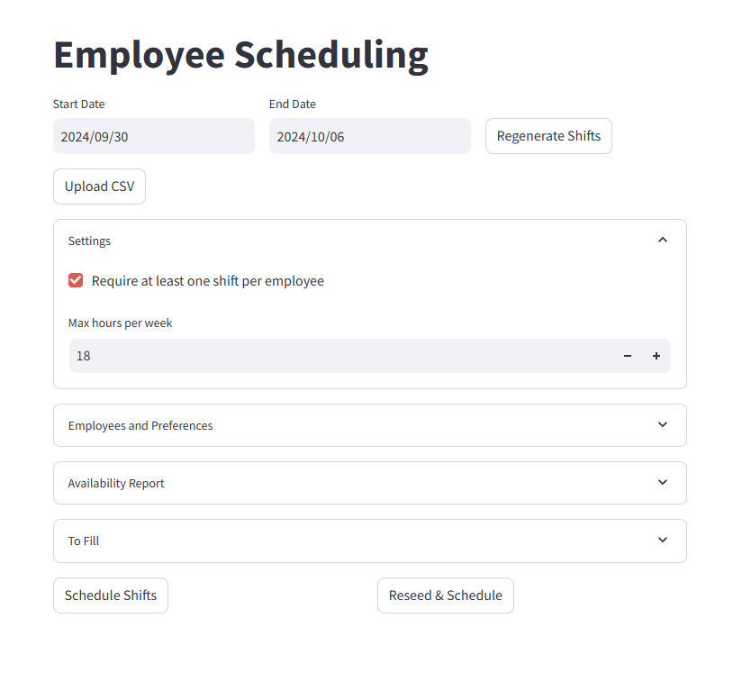

# Employee Scheduler

Build a weekly shift schedule from employee availability, staffing requirements and preferences. Review the result in a calendar, then export a CSV for import into Humanity.

[](https://github.com/Pop101/EmployeeScheduler/issues)



## Table of Contents

- [Overview](#overview)
- [Technologies](#technologies)
- [Setup](#setup)
- [Usage](#usage)

## Overview

The app uses heuristics and mathematical optimization to balance coverage with employee preferences. Start with its synthetic sample or bring your own preferences, availability, and positions to fill. Review the result before using it.

## Technologies

- [Streamlit](https://streamlit.io/)
- [OR-Tools](https://developers.google.com/optimization/)
- [Pandas](https://pandas.pydata.org/)
- [streamlit-calendar](https://github.com/im-perativa/streamlit-calendar)
- [dateparser](https://dateparser.readthedocs.io/)

## Setup

The manifest requires Python above 3.10. From a checkout with Poetry available:

```sh
poetry install
poetry run streamlit run app.py
```

Open [localhost:8501](http://localhost:8501). This command is checked against the repository; a clean install and hosted demo were not verified.

## Usage

1. Pick a window and try **Regenerate shifts** with sample data.
2. For your own schedule, upload your preferences, availability, and shifts to fill as CSV files. The preferences file needs `Employee`, `Tenure`, and `Preferred Hours`; you can also set maximum hours, slots, tags, and time preferences. See [`modules/parse_data.py`](modules/parse_data.py) for the accepted fields.
3. Choose **Schedule Shifts**, review coverage in the calendar, and export the result.

### Tags

There are many predefined tags that allow you to further customize individual employee preferences. These tags are:
- morning: employee prefers morning shifts
- afternoon: employee prefers afternoon shifts
- evening: employee prefers evening shifts
- night: employee prefers night shifts
- closing: employee prefers closing shifts (shifts starting after 8PM)
- opening: employee prefers opening shifts (shifts starting before 9AM)
- weekend: employee prefers weekend shifts
- noweekend: employee prefers no weekend shifts
- sunday: employee prefers Sunday shifts
- \<weekday\>: employee prefers shifts on a specific day of the week (e.g. monday, tuesday, wednesday, thursday, friday, saturday)

### Mixins

Mixins are Python functions that score a shift for an employee. Use only functions you wrote or trust in a private local setup; do not execute code from an untrusted upload.

### Humanity CSV workflow

In Humanity, choose **Reports → Employee → Availability (New)**, select the required dates and positions, and generate the report. Upload it into Employee Scheduler. To bring a reviewed schedule back, use **ShiftPlanning → Tools → Import Schedule** and select the exported CSV. Use synthetic records when sharing a demo.
